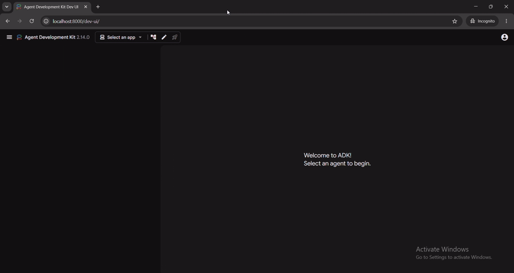
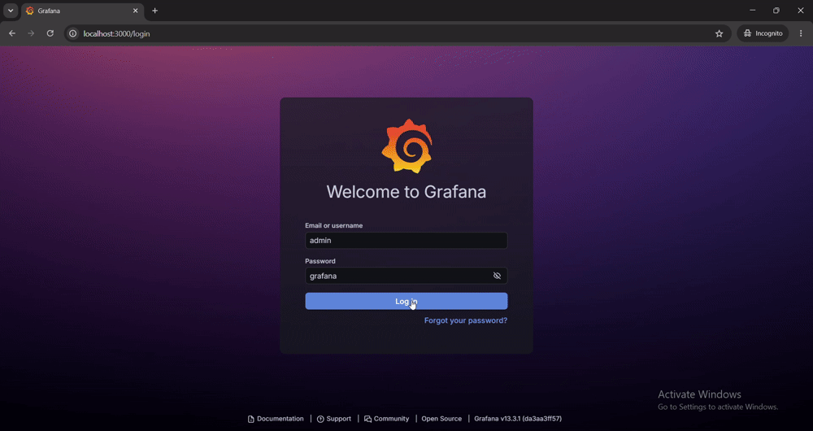

## README

### PROBLEM

CloudServe, a fictional client, faces challenges in maintaining high customer satisfaction while managing support agent attrition. The objective is to develop an autonomous support system that efficiently resolves customer queries, enhances customer satisfaction, reduces the workload and stress of support agents, and minimizes agent attrition through improved operational efficiency and employee experience.

### SOLUTION

This repository proposes an autonomous system that helps to reduce the workload of human agents by auto-responding to some of the user queries.

### ARCHITECTURE

The proposed solution's archiecture can be found at [docs/architecture.md](docs/architecture.md)

### DEPENDENCIES

1. Download the latest **docker engine** along with **docker compose**. Installation guides are available at [https://docs.docker.com/get-started/get-docker/](https://docs.docker.com/get-started/get-docker/)

2. For Windows, please install `wsl` and within wsl please use `Ubuntu` version. If using Mac, please be inside a bash shell.

3. Please install `make` in your Linux, or wsl (Ubuntu) or Mac bash shell. You might find the following command useful.

```bash
sudo apt update && sudo apt install make
```

### SETUP

1. Please go to the repository root folder. If using Windows then, please be inside wsl and go to the repostory root folder.

2. Copy .env.example to .env for app service.

```bash
cp app/.env.example app/.env
```

You can add an OpenRouter API key if you want to use LLM generated response otherwise, the system fallbacks to some generic response. To add the key update the `.env` file by assigning your OpenRouter API Key to `OPENROUTER_API_KEY`.

3. Execute the following command to start all the microservices.

```bash
make up
```

### EXECUTION

1. Open your browser at [http://localhost:8000/dev-ui](http://localhost:8000/dev-ui) . This opens the Google ADK Web. Here you can select the agent that's at the top most level.

2. Provide any ticket in expected JSON format and click send. This executes the pipeline of agents and evaluates whether the ticket should be `AUTO-RESPONDED` or `ESCALATED`.



3. Open your browser at [http://localhost:3000](http://localhost:3000) . This opens the Grafana login page. You can login using the user as `admin` and password as `grafana`. Here you navigate to the dashboard already built for visualization of different metrics.



### EVALS

To test the evals on validation dataset use:

```bash
make eval
```

To test the evals on development dataset use:

```bash
make eval
```

To test the evals on any other dataset present in your local directory use:

```bash
make test-eval args="./data/test_tickets.json"
```

The results are kept in the current directory under evalutation/results.

### UNINSTALL

1. The user might decide to bring down and remove all the microservices.

```bash
make down
```

2. If you would like to clean all the images please use:

```bash
docker system prune -a
```

Note that the above command deletes all the stopped container along with their images.