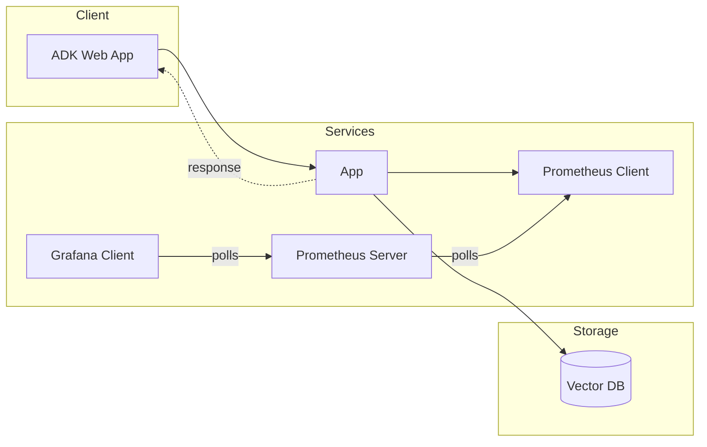
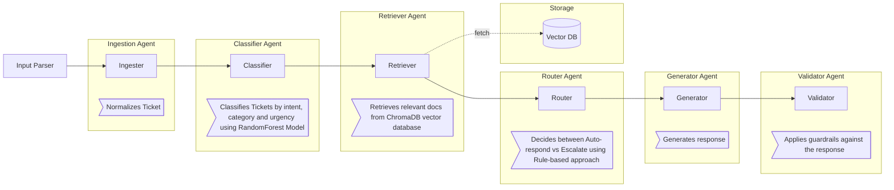

## ARCHITECTURE

The CloudServe ticket support system follows a micro-service archiecture. It includes components like the App, Prometheus Client, Prometheus Server and the Grafana. The **App** includes the main endpoints of this architecture. Grafana, Prometheus Client and Server are for visualizations of metrics through dashboard.

## High Level Architecture

The following diagram is a high-level archiecture of all the services in this micro-service architecture.

## App Service Architecture

The APP Service is the main service of this architecture. It follows an agentic approach. Here Google ADK has been used for orchestration of agents. Moreover, Chroma has been used as the vector database for storing the knowledge base of documents.

